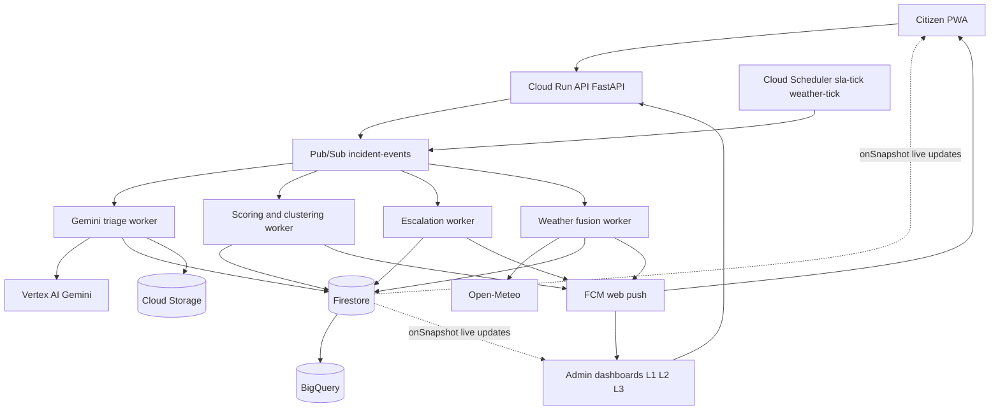

# Civicon AI: Cursor build spec (v2, redrafted)

Hyperlocal, AI-powered incident reporting, escalation and community-verified resolution.

How to use this file: put it in your repo root, create the files in section 9, then run the Cursor commands one at a time and test after each one. Order: `/01`, `/12` (design system), `/02` to `/07`, `/13` (notifications tab), `/08` to `/11`, then `/14` (polish).

---

## 1. Problem

In local communities, hazards and civic failures (blocked drains, flooding, fallen trees, live wires, garbage, road damage, safety issues) are reported through scattered calls, social media and ticket apps. Four things go wrong:

1. Nobody connects reports. Ten people report the same issue as ten tickets, and authorities cannot see that something is growing.
2. People nearby are not warned. Those about to walk or drive into the problem hear nothing.
3. Nothing escalates on its own. A report can sit unanswered at the lowest level with no deadline, and officials can close a ticket without anyone checking.
4. Weather is never joined to open problems. A heavy-rain forecast and an unresolved drain blockage nearby are two separate facts to every existing tool.

Fits the AI Builder Cup brief: disaster preparedness, community services, resilience, informed decision-making.

## 2. Proposed solution

A PWA with three kinds of users (citizens, local admins, higher authorities) and one AI-driven loop:

**Report → Cluster → Score → Route → Alert → Escalate → Community-verified close**

What citizens do:
- Report an incident with photo, video, voice note (Tamil/Hindi/English) or text. Location is captured with permission.
- See incidents near them or in any searched location.
- Promote an incident (like), comment, and follow a clean status tracker with a notification at every step.
- Confirm "resolved" or say "still unresolved" after an admin claims it is fixed.
- Save locations and get alerts for them. If the PWA is open, live updates and an in-app alarm.
- Weather and other auto-generated posts appear as simple posts with Promote, "Currently better", and Comments.

What AI does:
- Gemini reads the media and text, classifies intent, flags life-safety risk, suggests one or more departments, and checks whether it is a duplicate of a nearby incident.
- A scoring engine combines AI severity, unique reporters in the radius, promotes, exposure, and weather into a priority score with a visible reason.
- Deterministic rules escalate (see section 3). The AI recommends. Rules decide.
- Weather fusion: forecast × open incidents, e.g. "heavy rain in 6h, 3 unresolved drain issues within 500m of a low-lying road" alerts admins and nearby residents before the damage.

What makes it different from existing civic apps (verified by research): most stop at "photo on a map". This adds community-verified closure, the local escalation rule, SLA-driven multi-level escalation, and weather × incident fusion in one loop.

## 3. Product rules (build exactly these)

### 3.1 Status machine

`reported → triaged (AI) → assigned → in_progress → resolved_pending_verification → closed`

Side paths: `reopened` (from pending verification or closed), `escalated` is a flag plus `escalation_level` (1 local, 2 regional, 3 higher), not a status. Every transition writes an append-only `timeline` entry and notifies reporters and promoters.

### 3.2 Hard rules (evaluated before any score)

| Rule | Trigger | Action |
|---|---|---|
| R1 local threshold | 5 or more unique independent reporters on one incident (or cluster) within 24h | Mark priority at least High, notify L1 admins, flag `escalated_by_threshold` |
| R2 life safety | category in life-safety list OR Gemini `life_safety_risk.flag` with confidence 0.6 or more | Notify L1 and L2 immediately regardless of count, set `human_review_required` |
| R3 SLA breach | acknowledge or resolve deadline passed | Move to next level, attach timeline and evidence |
| R4 community dispute | 2 or more "still unresolved" votes after admin marked resolved | Reopen and escalate one level |

Life-safety categories (config): fire, electrical hazard, building or tree collapse, flooding into homes, injury or accident, gas leak, crime in progress.

### 3.3 Priority score (illustrative weights, tune on test cases)

```
priority = 100 * (0.30*ai_severity + 0.25*corroboration + 0.15*community
                  + 0.15*exposure + 0.15*urgency)
```

- ai_severity: Gemini 0 to 1
- corroboration: min(1, unique_reporters / 5)
- community: min(1, ln(1 + promotes) / ln(21)), reduced by "currently better" votes
- exposure: school, hospital, main road or low-lying area within 300m (Places or seeded data)
- urgency: age vs SLA, plus weather multiplier from weather fusion

Labels: 0 to 39 Low, 40 to 64 Medium, 65 to 84 High, 85 or above Critical. Always store `factors` so the UI can show "why this score".

Anti-abuse: count unique users only, rate-limit reports per user, require reporter within 500m of the incident or mark "remote report" at lower weight, cap promote influence, never let reputation block an emergency.

### 3.4 Default SLA table (admin-configurable)

| Priority | Acknowledge within | Resolve within | Escalate to |
|---|---|---|---|
| Critical | 15 min | 4 h | L2 at 15 min, L3 at 1 h |
| High | 1 h | 24 h | L2 at 1 h, L3 at 12 h |
| Medium | 4 h | 72 h | L2 at 4 h, L3 at 48 h |
| Low | 24 h | 7 d | L2 at 24 h |

AI may propose a shorter deadline within these bounds. It must never invent longer ones or legal timelines. Demo mode: a config flag scales all times down (minutes instead of hours).

### 3.5 Community verification

Admin sets `resolved_pending_verification`. Reporters and promoters get "Is this fixed? Yes / Still a problem". Close when at least 2 yes and 60% or more yes. If the window ends (default 48h) with no "no" votes, close as `closed_unverified`. 2 or more "no" votes triggers R4. One vote per user, only eligible users.

### 3.6 Auto posts (weather and similar)

Stored as incidents with `source: "auto_weather"`. Actions: Promote, Currently better, Comments. "Currently better" votes feed back as ground truth and reduce urgency.

### 3.7 Visibility and ownership

Every report is visible on L1 and L2 boards regardless of AI escalation. Admins can drag any incident into "My board" to claim it. Anyone can browse incidents by searching a location.

### 3.8 Safety and privacy

Show "For emergencies call 112" on the report screen. Reporter identity is never public. Optional anonymous mode. Public coordinates are rounded for sensitive categories. Ask permission before using location. Offer manual location pick. No background tracking.

### 3.9 Notifications tab and delivery rules

One source of truth, two channels. Every notification appears in the in-app **Notifications** tab (live through Firestore `onSnapshot`). Push is a filtered subset, because pushing everything teaches people to switch it off.

Tabs by role:

| Role | Tabs |
|---|---|
| Citizen | **For you** (progress on my reports, replies, "Is it fixed?" requests), **Nearby** (every new incident in my saved locations and current area), **Alerts** (weather, safety, escalations on things I follow) |
| L1 admin | **Inbox** (assigned or claimed by me, SLA warnings), **New in region** (every new report), **Overdue** |
| L2 admin | **Escalated to me**, **New in region** (every report), **Overdue** across departments |
| L3 | **Escalated to me**, **Persistent issues**, regional digest |

Recipient matrix (defaults, configurable in preferences). P = push and in-app, I = in-app only, "-" = none.

| Event | Reporter and promoters | Residents near the incident | L1 | L2 | L3 |
|---|---|---|---|---|---|
| New report triaged | I (confirmation) | I (P if High or above) | I (P if High or above, or routed to their department) | I | - |
| Status change (assigned, in progress, resolved pending) | P | I (resolved near you) | I | I if escalated | - |
| "Is it fixed?" verification request | P | - | - | - | - |
| 5-report threshold (R1) | I ("5 people reported this") | P | P | I | - |
| Life safety (R2) | P | P | P | P | I |
| SLA breach or escalation | I ("moved to the next level") | - | P | P if escalated to L2 | P if escalated to L3 |
| Reopened by community (R4) | P | I | P | P | I |
| Weather fusion alert | P | P | P | I | - |
| Auto weather post | - | I (P if user opted in) | I | - | - |

Rules:
- **Thread per incident.** One notification item per user per incident, updated in place ("5 people reported this", "Now in progress"), not five separate items. Use the FCM `tag` or collapse key so the phone replaces the old push.
- **Push limits.** Maximum 5 non-critical pushes per user per hour. Quiet hours (default 11 pm to 6 am) hold non-critical push. R2 life-safety bypasses quiet hours.
- **Preferences.** Per saved location: incidents on or off, weather on or off. Also minimum severity for push, quiet hours, and language. Admins choose which departments and categories push to them.
- **Cheap fan-out.** Personal and escalation items are per-user documents. The "Nearby" and "New in region" feeds are live queries (geohash or region plus `created_at`) with a per-user `last_seen` cursor to compute unread. Do not write a document per resident per incident.
- **Act from the card.** Each item deep-links to the incident. "Is it fixed?", Promote and "Currently better" work inline.
- **Show departments, not officers.** Say "Taken up by Municipal drainage", never an individual officer's name.
- The tab icon shows a live unread badge.

## 4. Architecture



Flow notes:
- Live updates when the PWA is open use Firestore `onSnapshot` (no custom WebSockets).
- Push when closed uses FCM web push (Chrome, Edge, Firefox, Android; iOS 16.4+ only if installed to home screen).
- Geo-matching is server-side: saved locations are stored with a geohash, candidates are pre-filtered by geohash prefix, then exact haversine distance decides.
- Workers are one Cloud Run service with different endpoints if you want less ops. Split later.

## 5. Technologies

| Layer | Choice | Why |
|---|---|---|
| Frontend | Next.js (App Router) + TypeScript + Tailwind | One codebase, role-based layouts |
| PWA | manifest.json + service worker + `firebase-messaging-sw.js` | Install, push, offline shell |
| Maps | Google Maps JavaScript API (`@vis.gl/react-google-maps`) | GCP-aligned. Fallback: Leaflet + OpenStreetMap, no key |
| Auth | Firebase Auth (Google sign-in, email link) with custom claims for roles | Phone OTP optional (needs billing and SMS) |
| Backend | Python FastAPI on Cloud Run | Policy, scoring, escalation, AI calls |
| AI | Gemini on Vertex AI through `google-genai` SDK (`vertexai=True`) | Multimodal: image, video, audio, text |
| Realtime and data | Firestore + `geofire-common` geohash | Live listeners and simple geo queries |
| Media | Cloud Storage with signed upload URLs | Photos, video, audio, repair evidence |
| Events | Pub/Sub + Cloud Scheduler | Async triage, SLA ticks, weather ticks |
| Analytics | BigQuery (Firestore export or streaming inserts) | Recurrence, hotspots, response times |
| Weather | Open-Meteo (no key). Optional: OpenWeatherMap | Forecast and alerts |
| Push | FCM web push (VAPID) | Works for PWA |
| Stretch | Earth Engine, Twilio or Exotel voice call for Critical only | Not needed for MVP |

Honest PWA limits (put these in your pitch Q&A):
- A web push cannot ring like a phone call or play a custom sound. Use push when closed, and a full-screen in-app alarm with sound and vibration when open (user must tap "Enable alerts" once so audio is allowed).
- No background location in PWAs. "Navigating toward an incident" works only while the app is open. Otherwise match against saved locations server-side.

## 6. Data model (Firestore)

```
regions/{regionId}            name, center, radius_m, categories[], sla_config, demo:true
departments/{deptId}          regionId, name, level(1|2|3), categories[], officer_uids[]
users/{uid}                   role(citizen|admin_l1|admin_l2|admin_l3|super), regionId, displayName, push_tokens[]
users/{uid}/saved_locations/{id}   label, lat, lng, geohash, radius_m, alerts{incidents,weather}
incidents/{id}                source(user|auto_weather), category, title, summary, location{lat,lng,geohash,accuracy_m},
                              regionId, status, escalation_level, escalated_by_threshold, human_review_required,
                              priority{score,label,factors[]}, ai{...}, assigned_dept_ids[], claimed_by,
                              sla{ack_due,resolve_due}, counters{unique_reporters,promotes,better,yes,no,comments},
                              created_at, updated_at
incidents/{id}/reports/{rid}  uid, text, media[{gcs_uri,type}], location, gps_exif_mismatch, created_at
incidents/{id}/votes/{uid_type}  type(promote|better|resolved_yes|resolved_no), uid, created_at
incidents/{id}/comments/{cid} uid, text, created_at
incidents/{id}/timeline/{tid} actor, type, from, to, note, evidence[], at          (append-only)
notifications/{uid}/items/{nid}   type, incident_id, group_key(uid+incident), title, body, count, priority,
                              pushed(bool), actions[], read, created_at, updated_at
users/{uid} (add fields)      notification_prefs{push_min_priority, quiet_hours{start,end}, per_location{}, dept_filters[]},
                              last_seen{nearby_at, region_at}
```

Firestore security rules: clients can read incidents in their region and write only their own votes, comments and saved locations. Status, priority, counters, escalation and timeline are server-written only. Timeline allows `create` and denies `update` and `delete`.

## 7. API (FastAPI)

```
GET  /v1/uploads/sign                      signed URL for media upload
POST /v1/incidents                         create report (merges into nearby incident when AI says duplicate)
GET  /v1/incidents?lat&lng&radius_m&category&status
GET  /v1/incidents/{id}
POST /v1/incidents/{id}/promote            one per user
POST /v1/incidents/{id}/better             auto posts
POST /v1/incidents/{id}/comments
POST /v1/incidents/{id}/verify             {answer: "resolved" | "unresolved"}
POST /v1/me/saved-locations
POST /v1/me/push-token
GET  /v1/notifications?tab&cursor          paged items for the Notifications tab
POST /v1/notifications/{id}/read
POST /v1/notifications/read-all
PUT  /v1/me/notification-prefs
POST /v1/admin/incidents/{id}/claim        drag to my board
POST /v1/admin/incidents/{id}/status       {status, note, evidence[]}
POST /v1/admin/incidents/{id}/assign       {dept_ids[]}
POST /internal/events                      Pub/Sub push target
POST /internal/tick/sla                    escalation checks
POST /internal/tick/weather                forecast fusion
```

Every protected route checks role from the Firebase ID token server-side.

## 8. Gemini contract

Send: media (GCS URIs), user text, user-chosen department (optional), up to 10 nearby open incidents as candidates `{id, category, summary, distance_m, age_min}`.

Return JSON only, validated with Pydantic, and store under `incident.ai`:

```json
{
  "is_valid_civic_issue": true,
  "spam_likelihood": 0.05,
  "category": "drainage",
  "summary_en": "Blocked storm drain with water pooling on the road",
  "original_language": "ta",
  "transcript": "",
  "observations": ["water 10 cm deep", "drain covered with plastic"],
  "life_safety_risk": {"flag": false, "reason": "", "confidence": 0.2},
  "severity_0_1": 0.55,
  "evidence_confidence_0_1": 0.7,
  "suggested_departments": [{"name": "Municipal drainage", "confidence": 0.8}],
  "same_issue_as": ["incidentId or empty"],
  "followup_question": "",
  "human_review_required": false
}
```

Rules: if the call fails or validation fails, store `ai.status = "failed"`, use category base severity, set `human_review_required = true`. Never fabricate a success. Model name comes from the `GEMINI_MODEL` env var.

Photo authenticity check (cheap): compare EXIF GPS and timestamp with device GPS and upload time. Store `gps_exif_mismatch`. Lower evidence weight, do not auto-reject.

## 9. Cursor setup

### 9.1 Terminal commands (run once)

```bash
mkdir civicon-ai && cd civicon-ai && git init
npx create-next-app@latest frontend --ts --tailwind --eslint --app --src-dir --import-alias "@/*"
cd frontend && npm i firebase @vis.gl/react-google-maps geofire-common zod lucide-react && cd ..
mkdir backend && cd backend && python -m venv .venv && source .venv/bin/activate
pip install fastapi "uvicorn[standard]" pydantic google-genai google-cloud-firestore google-cloud-storage \
  google-cloud-pubsub google-cloud-bigquery firebase-admin httpx pytest python-multipart
pip freeze > requirements.txt && cd ..
mkdir -p data docs .cursor/rules .cursor/commands
```

GCP setup:

```bash
gcloud auth login
gcloud auth application-default login
gcloud config set project YOUR_PROJECT_ID
gcloud services enable aiplatform.googleapis.com run.googleapis.com pubsub.googleapis.com \
  cloudscheduler.googleapis.com storage.googleapis.com bigquery.googleapis.com firestore.googleapis.com \
  cloudbuild.googleapis.com artifactregistry.googleapis.com maps-backend.googleapis.com places.googleapis.com \
  fcm.googleapis.com
gcloud pubsub topics create incident-events
gcloud pubsub topics create sla-tick
gcloud pubsub topics create weather-tick

# Database (skip if you already created Firestore in the Firebase console; it will say "already exists")
gcloud firestore databases create --location=asia-south1

# Media bucket (name must be globally unique)
gcloud storage buckets create gs://YOUR_UNIQUE_BUCKET --location=asia-south1
```

Bucket CORS (needed for browser uploads through signed URLs). Save as `cors.json`, then apply:

```json
[{"origin": ["http://localhost:3000", "https://YOUR_DEPLOYED_DOMAIN"],
  "method": ["PUT", "GET"], "responseHeader": ["Content-Type"], "maxAgeSeconds": 3600}]
```
```bash
gcloud storage buckets update gs://YOUR_UNIQUE_BUCKET --cors-file=cors.json
```

Firebase CLI (to deploy Firestore security rules and indexes):

```bash
npm i -g firebase-tools
firebase login
firebase init firestore        # choose your project; keep firestore.rules and firestore.indexes.json
firebase deploy --only firestore:rules,firestore:indexes
```

Scheduler jobs: create them **paused** so they do not fire into an empty system. Resume them in `/11` after the backend is deployed.

```bash
gcloud scheduler jobs create pubsub sla-tick-job --location=asia-south1 --schedule="* * * * *" --topic=sla-tick --message-body='{}'
gcloud scheduler jobs create pubsub weather-tick-job --location=asia-south1 --schedule="*/30 * * * *" --topic=weather-tick --message-body='{}'
gcloud scheduler jobs pause sla-tick-job --location=asia-south1
gcloud scheduler jobs pause weather-tick-job --location=asia-south1
# later, in /11:  gcloud scheduler jobs resume sla-tick-job --location=asia-south1  (same for weather-tick-job)
```

If Firestore later throws "query requires an index", open the link in the error message to create the index (or add it to `firestore.indexes.json`). This is normal.

### 9.2 `.cursor/rules/project.mdc`

```
---
alwaysApply: true
---
Project: Civicon AI, a hyperlocal incident PWA. Read CIVICON_AI_cursor_spec.md before any task.
- Frontend: Next.js App Router, TypeScript, Tailwind. Backend: FastAPI on Cloud Run. Data: Firestore. AI: Gemini on Vertex AI.
- AI recommends, deterministic rules decide escalation (spec section 3). Never let the model set deadlines.
- Never hard-code keys. Read env vars. Keep a .env.example. Server-side role checks on every protected route.
- Validate all Gemini output with Pydantic. On failure use the fallback in spec section 8. Never fake AI success.
- Status, priority, counters and timeline are server-written only. Timeline is append-only.
- Work in small steps. After each step run the app and tests and report what works. No giant untested code dumps.
- Mobile-first, accessible UI. Label the environment as DEMO. Do not claim real government affiliation.
- Cloud Run: listen on $PORT (0.0.0.0), stay stateless, config from env vars, auth with the service account (no key files), JSON logs to stdout, /health endpoint.
- Do not rely on FastAPI BackgroundTasks for important work on Cloud Run (CPU may be throttled after the response). Use Pub/Sub push to /internal/events.
```

### 9.3 Custom commands (save each block as `.cursor/commands/NAME.md`, run as `/NAME`)

**01-scaffold.md**
```
Read CIVICON_AI_cursor_spec.md. The product name is Civicon AI (slug civicon-ai). Use it for the PWA manifest name and short_name,
page titles, package names and README. Propose the folder structure and set up: frontend shell with role-based layouts
(citizen, admin), PWA manifest and installable setup, .env.example with all variables from spec section 10, FastAPI skeleton
with /health, shared TypeScript and Pydantic models from spec section 6. Run both apps and confirm they start.
```

**02-auth-roles.md**
```
Add Firebase Auth (Google sign-in). Roles via custom claims: citizen, admin_l1, admin_l2, admin_l3, super.
Backend dependency that verifies the ID token and enforces role per route. Seed script creating one demo region,
departments for levels 1 to 3, and demo users (clearly labelled DEMO). Write Firestore security rules from spec section 6 and tests.
```

**03-report-flow.md**
```
Build the report wizard: photo, video, voice note or text, category (optional), department (optional), location via
browser geolocation with permission prompt and manual map pick fallback. Signed upload to Cloud Storage. POST /v1/incidents
stores the report and incident with status "reported". Add the nearby feed and map with search by location. Show "Call 112 for emergencies".
```

**04-gemini-triage.md**
```
Implement the triage worker using google-genai with vertexai=True, model from GEMINI_MODEL. Input: media GCS URIs, text,
nearby candidate incidents. Output validated by the Pydantic schema in spec section 8. Add the EXIF vs device GPS check.
Implement the failure fallback. Unit test with mocked responses and one test for invalid JSON.
```

**05-scoring-escalation.md**
```
Implement clustering (same category group, radius by category, 24h window), unique reporter counting, the priority formula
and hard rules R1 to R4 from spec section 3, SLA table with a DEMO_TIME_SCALE env var, and the escalation worker triggered by
the sla-tick topic. Store priority.factors so the UI can explain the score. Write tests for: 5 reports triggers R1, life-safety
triggers R2 with 1 report, missed ack escalates to L2, duplicate users are not double counted.
```

**06-votes-verification.md**
```
Implement promote, comments, "currently better" for auto posts, and the community verification flow from spec section 3.5
(resolved_pending_verification, yes/no votes, close, reopen and R4). One vote per user per type. Notify reporters and promoters
on every status change. Add the status tracker timeline component.
```

**07-notifications.md**
```
Add saved locations with radius and geohash. Add FCM web push: firebase-messaging-sw.js, permission request on a user tap,
token registration. Server-side geo matching (geohash prefilter then haversine) when an incident is created, escalated or
a weather post is created. Add Firestore onSnapshot live updates and a full-screen in-app alarm with sound and vibration
when the PWA is open (unlock audio on a user tap). Implement the recipient matrix, push limits, quiet hours and thread-per-incident grouping from spec section 3.9
(a notifier function that plans recipients per event). The in-app tab UI is built in /13.
```

**08-weather-fusion.md**
```
Implement the weather worker on weather-tick: fetch Open-Meteo forecasts for each region grid cell and saved-location cluster.
When rain or heat thresholds are crossed create an auto_weather post. Fuse forecast with open drainage, tree and electrical
incidents within 500m, raise urgency, notify admins and nearby users. Posts support Promote, Currently better, Comments.
```

**09-dashboards.md**
```
Build the dashboards: citizen home (nearby, saved locations, my reports), L1 kanban (Incoming, My board, In progress, Pending
verification, Closed) with drag to claim, L2 board with escalated and overdue items and department workload, L3 view of
persistent escalations. Incident detail with AI summary, score reasons, evidence, timeline and comments. Clean, minimal UI.
```

**10-demo-seed.md**
```
Create data/demo_incidents.json with 20 to 30 clearly synthetic incidents around one fictional neighbourhood plus a script
to seed Firestore. Add a demo control page to fast-forward time (DEMO_TIME_SCALE), trigger a weather post, and simulate
5 reports. Add BigQuery export and a view for recurrence: "this location had N similar incidents".
```

**11-deploy.md**
```
Name the Cloud Run services civicon-api and civicon-web. Write Dockerfiles for backend, deploy backend to Cloud Run (asia-south1) with a service account, Pub/Sub push subscriptions
to /internal/events with OIDC auth, deploy frontend (Cloud Run or Firebase Hosting), and write docs/DEPLOY.md and README with
setup steps, env vars and the demo walkthrough.
```

**12-ui-system.md** (run right after `/01`, before building screens)
```
Read spec section 13. Set up design tokens as Tailwind theme plus CSS variables (light and dark), fonts through next/font
(Bricolage Grotesque for headings and numbers, Hind Madurai for body, which covers Latin and Tamil), and English/Tamil
switching with next-intl. Build base components: Button, Chip, SeverityBadge (icon plus label, never colour alone),
JourneyLine, BottomSheet, TabBar with badge, Skeleton, EmptyState, Toast. Add a /design page showing every component in
both themes and both languages. Run the app, check at 390px and 1280px width, and fix spacing, contrast and focus issues.
```

**13-notifications-tab.md** (run after `/07`)
```
Build the Notifications tab from spec section 3.9, with tabs per role. Items are one thread per incident with a mini
JourneyLine, latest update, "+N updates", unread dot and inline actions (Is it fixed? Yes / Still a problem, Promote).
Live updates through onSnapshot, live unread badge on the tab icon, filter chips (location, category, severity), mark all
read, and a preferences screen (per-location toggles, minimum severity for push, quiet hours, language). Nearby and
New in region are live queries with a last_seen cursor. Add empty states with a clear next action.
```

**14-ui-polish.md** (run last)
```
Review every screen against spec section 13. Check: report flow takes under 30 seconds, optimistic Promote, skeleton loaders,
offline queue for reports, reduced-motion support, keyboard focus, contrast 4.5:1, 44px touch targets, Tamil text not clipped,
dark mode. Remove any decoration that does not carry information. Take screenshots at 390x844 and 1280x800 and list what you changed.
```

## 10. APIs, keys and accounts to keep ready

| # | Item | Where to get it | Env var / use |
|---|---|---|---|
| 1 | GCP project with billing (hackathon credits) | console.cloud.google.com | `GOOGLE_CLOUD_PROJECT` |
| 2 | gcloud login and ADC | `gcloud auth login` and `gcloud auth application-default login` | Local dev auth for Vertex, Firestore, Storage |
| 3 | Enabled APIs | gcloud command in 9.1 | Vertex AI, Cloud Run, Pub/Sub, Scheduler, Storage, BigQuery, Firestore, Maps, Places, FCM |
| 4 | Firebase project linked to the GCP project and a Web app | console.firebase.google.com | `NEXT_PUBLIC_FIREBASE_API_KEY`, `..._AUTH_DOMAIN`, `..._PROJECT_ID`, `..._STORAGE_BUCKET`, `..._MESSAGING_SENDER_ID`, `..._APP_ID` |
| 5 | Firebase Auth enabled (Google, email link) | Firebase console, Authentication | Roles set with custom claims via Admin SDK |
| 6 | FCM Web Push certificate (VAPID key pair) | Firebase console, Project settings, Cloud Messaging, Web configuration | `NEXT_PUBLIC_FIREBASE_VAPID_KEY` |
| 7 | Cloud Run service account roles | IAM | `roles/datastore.user`, `roles/aiplatform.user`, `roles/storage.objectAdmin`, `roles/pubsub.publisher`, `roles/bigquery.dataEditor`, `roles/bigquery.jobUser`, `roles/firebasecloudmessaging.admin`, plus `roles/iam.serviceAccountTokenCreator` on itself for signed upload URLs. No JSON key files in the repo. For local dev, if signed URLs fail with your user credentials, upload through the API (multipart) instead. |
| 8 | Maps JavaScript API key (restrict by HTTP referrer and API) | Cloud Console, Credentials | `NEXT_PUBLIC_GOOGLE_MAPS_API_KEY` (optional Map ID) |
| 9 | Gemini model ID | Vertex AI Model Garden. Check the current Flash-class ID and region availability. | `GEMINI_MODEL`, `GOOGLE_CLOUD_LOCATION` (Gemini region may differ from data region) |
| 10 | Fast local fallback for Gemini | Google AI Studio API key | `GEMINI_API_KEY` (dev only, switch back to Vertex for the demo) |
| 11 | Open-Meteo | No key needed for the free non-commercial tier | `WEATHER_BASE_URL=https://api.open-meteo.com/v1/forecast` |
| 12 | Internal endpoint protection | Generate a random string | `INTERNAL_TASK_SECRET` (or OIDC on Pub/Sub push) |
| 13 | Storage bucket and Pub/Sub topics | gcloud | `GCS_BUCKET`, `PUBSUB_TOPIC_EVENTS=incident-events` |
| 14 | Optional: OpenWeatherMap key, Twilio or Exotel (voice call for Critical), Earth Engine registration, Sentry | Respective consoles | Stretch only |

`.env.example` (backend and frontend):

```
GOOGLE_CLOUD_PROJECT=
GOOGLE_CLOUD_LOCATION=us-central1
GEMINI_MODEL=
GEMINI_API_KEY=
GCS_BUCKET=
PUBSUB_TOPIC_EVENTS=incident-events
INTERNAL_TASK_SECRET=
WEATHER_BASE_URL=https://api.open-meteo.com/v1/forecast
DEMO_TIME_SCALE=1
NEXT_PUBLIC_API_BASE_URL=http://localhost:8000
NEXT_PUBLIC_FIREBASE_API_KEY=
NEXT_PUBLIC_FIREBASE_AUTH_DOMAIN=
NEXT_PUBLIC_FIREBASE_PROJECT_ID=
NEXT_PUBLIC_FIREBASE_STORAGE_BUCKET=
NEXT_PUBLIC_FIREBASE_MESSAGING_SENDER_ID=
NEXT_PUBLIC_FIREBASE_APP_ID=
NEXT_PUBLIC_FIREBASE_VAPID_KEY=
NEXT_PUBLIC_GOOGLE_MAPS_API_KEY=
```

## 11. Demo script (3 to 4 minutes)

1. A citizen records a Tamil voice note and photo of a blocked drain. Gemini transcribes, classifies, and suggests Municipal drainage plus Revenue (VAO).
2. Four more nearby citizens report. The fifth triggers R1. The L1 admin gets a push and the incident shows "why this priority".
3. Weather fusion fires: rain in 6h plus the open drain issues. Residents with saved locations nearby get a push. A phone with the PWA open shows the in-app alarm.
4. The L1 admin acknowledges but misses the SLA (demo time scaled). The incident escalates to L2 with its full timeline.
5. Admin marks resolved. Reporters are asked to confirm. Two say "still a problem". It reopens and escalates. Show the tracker.
6. Close with the BigQuery line: "This location had 3 similar incidents in 60 days."

## 12. Do not claim

- Do not claim the idea is unique. Similar civic apps exist. Claim the integrated loop: community-verified closure, local escalation threshold, SLA hierarchy, and weather × incident fusion.
- Do not claim real government integration. Label all officials and data as DEMO.
- Do not claim calls or custom ringtones from a PWA.
- Weights in section 3.3 are starting values, not validated coefficients.

## 13. UI/UX direction

Goal: a mobile-first app that feels like a calm, trustworthy neighbourhood tool, not a government form. Design for a person standing next to a flooded street holding a phone in one hand. Admin screens get the same system, laid out for a desktop.

### 13.1 Design plan (starting tokens; refine after seeing real screens)

**Colour**

| Name | Hex | Use |
|---|---|---|
| Paper | `#F5F7FA` | Page background (cool, not cream) |
| Ink | `#0F1B2D` | Text, dark-mode surfaces |
| Marina blue | `#1F4FD8` | Primary actions, links, selected tab |
| Resolved green | `#1E9E63` | Fixed and verified states |
| Water cyan | `#0AA2C0` | Weather and rain content |
| Alert red | `#C8102E` | Critical only |

Severity scale (always paired with an icon and a word, never colour alone): Low `#7A8B99`, Medium `#E0A100`, High `#E8590C`, Critical `#C8102E`. Dark mode: Ink background `#0F1B2D`, raised surface `#17263B`, check contrast again.

**Type.** Headings and numbers: Bricolage Grotesque. Body and Tamil: Hind Madurai (Latin and Tamil in one family). Confirm both on Google Fonts and load with `next/font`. Base 16px, line-height 1.5 for English and 1.6 for Tamil, line length under 70 characters. Sentence case everywhere.

**Layout concept (mobile).** Map first. A bottom sheet with three snap points (peek, half, full) holds the nearby feed. Bottom tab bar:

```
 Nearby | Notifications (badge) | [ Report ] | My reports | Me
```

Report is the one raised centre button.

```
HOME                          NOTIFICATIONS                    INCIDENT DETAIL
+------------------------+    +------------------------+      +------------------------+
| Search a place     [o] |    | For you  Nearby  Alerts|      | Blocked drain, T Nagar |
|                        |    | [Chips: Home | High+ ] |      | High · 5 reported      |
|   map with pulse rings |    |------------------------|      | [photo / video strip]  |
|        (o)   (O)       |    | Blocked drain, T Nagar |      |                        |
|                        |    | o--o--o----o  In prog.|      | o--o--o--o--o  journey |
|------------------------|    | "Now in progress"  2m  |      | Reported > ... > Closed|
| Nearby (3 High)  ====  |    |------------------------|      |                        |
| row row row            |    | Is your street fixed?  |      | Why High? [expand]     |
|                        |    | [Yes, fixed] [Still a  |      | [Promote 12] [Comment] |
+------------------------+    |  problem]              |      | Timeline, comments     |
                              +------------------------+      +------------------------+
```

**Admin (desktop).** Left: kanban (Incoming, My board, In progress, Pending verification, Closed). Right: map. Each card shows an SLA countdown ring. Side panel shows the AI summary, "why this priority", evidence and timeline.

### 13.2 The one memorable element: the Journey Line

A horizontal tracker like a delivery tracker, used on incident detail, My reports and inside every notification: Reported, Reviewed, Assigned, In progress, Fixed?, Closed. Each step shows who did it (department) and when. Escalation appears as a small ladder (L1 > L2 > L3) with the SLA ring. Spend the visual boldness here and keep everything else quiet. Supporting touches, kept subtle:
- Pulse rings on the map only for High and Critical incidents. Ring size is priority. Respect reduced motion.
- Before and after photo slider on the "Is it fixed?" card. The admin must upload an after photo to mark resolved.
- Auto weather posts use Water cyan and a rain icon. "Currently better" is a toggle chip.

### 13.3 What to avoid (common generated-UI tells)

No all-caps labels or eyebrows above headings. No gradient washes. No identical rounded cards for everything: use plain list rows for feeds and use cards only when there is media. No arrows appended to button text. No decorative animation on every card. Cut any element that carries no information.

### 13.4 Interaction rules

- **Report in under 30 seconds.** Open the camera or mic first. Location is automatic with a manual map pin as fallback. Then show the AI draft as editable chips (category, department, severity) with a short "Why" line. One submit button.
- **Show AI honestly.** Label AI suggestions as suggestions. Always show "Why this priority".
- **Fast and forgiving.** Optimistic Promote, skeleton loaders, offline queue for reports (retry when online), and undo for accidental actions.
- **Install prompt** after the first successful report, not on first load. On iPhone, show a short "Add to Home Screen" sheet, because push needs it.
- **Audio alarm** only after the user taps "Enable alerts" once. Always provide a mute.
- **Language.** English and Tamil toggle in the header. Voice reports accept Tamil, Hindi and English.

### 13.5 Copy

Plain verbs, sentence case, the same name for an action everywhere. Examples:
- Buttons: "Report a problem", "Promote", "Currently better", "Yes, it's fixed", "Still a problem"
- Status: "Waiting for review", "Taken up by Municipal drainage", "Fixed, waiting for your confirmation"
- Error: "Couldn't upload the video. It's longer than 15 seconds. Trim it or send a photo instead."
- Empty Nearby: "No reports near you right now. Save another place to watch it."

### 13.6 Quality floor

Contrast 4.5:1 or better, visible keyboard focus, 44px touch targets, `prefers-reduced-motion` respected, labels for screen readers, text scales without clipping Tamil, dark mode, responsive from 360px up. Check every screen at 390x844 and 1280x800. If your Cursor version has a browser tool, ask it to open the app and screenshot each screen.

## 14. Setup notes, cost guard rails, other tools

**Cost guard rails (Google Cloud free trial, about $300 credit)**
1. Create a budget alert in Billing with email alerts to billing admins and project owners. Skip the Pub/Sub and Monitoring options.
2. Do not click "Activate" or "Upgrade to paid account" until after the demo. The trial cannot bill you beyond the credit.
3. Deploy Cloud Run with `--min-instances=0 --max-instances=3`.
4. Cap uploads at 10 to 15 seconds of video and a few MB per photo. Cache each AI result so a report is analysed once.
5. Use one Google account and one project for everything. Do not create extra accounts for extra credit.
6. After the demo, delete the project.

**Zero-credit variant (only if you have no trial credit)**
Gemini through `GEMINI_API_KEY` from Google AI Studio, Leaflet + OpenStreetMap instead of Google Maps, no Pub/Sub (call workers directly), no BigQuery, run the backend locally or on a free host, scheduled jobs through an external cron or a "run tick now" demo button. Firebase Auth, Firestore and FCM stay.

**Using Codex or another tool instead of Cursor**
The `.cursor/commands` files only work in Cursor. For Codex, copy the rules block from section 9.2 (without the `---` header) into `AGENTS.md` in the project root, then paste each command's text as a normal prompt that starts with "Read CIVICON_AI_cursor_spec.md first." Keep the same run order. Sign in with ChatGPT rather than an API key to avoid per-token billing.

**Order of setup**
GCP project and budget, gcloud login, enable APIs, topics, Firestore, bucket and CORS, Firebase (Auth, web app, VAPID key), env files, then `/01`.

**Maps API key setup (skip if you use Leaflet + OpenStreetMap)**
1. Console, APIs & Services, Credentials, Create credentials, API key. Copy it.
2. Edit the key. Application restrictions: Websites (HTTP referrers). Add `http://localhost:3000/*` and later your deployed domain `https://YOUR_DOMAIN/*`. API restrictions: Restrict key, choose Maps JavaScript API and Places API (New) only.
3. Put it in `frontend/.env.local` as `NEXT_PUBLIC_GOOGLE_MAPS_API_KEY`. It is visible in the browser, so the restrictions are your protection. Never put this key in the backend or commit it.
4. APIs & Services, Maps JavaScript API, Quotas: set a low daily request cap so a bug cannot run up usage.
5. Optional: create a Map ID (Google Maps Platform, Map Management) if you want advanced markers or custom map styling, and put it in `NEXT_PUBLIC_GOOGLE_MAP_ID`.

**Naming used across the project**
Product: Civicon AI. Repo and folder: `civicon-ai`. PWA manifest `name`: "Civicon AI", `short_name`: "Civicon". Cloud Run services: `civicon-api`, `civicon-web`. Suggested bucket: `civicon-ai-media-<random suffix>` (bucket names are global, so add your own suffix).
